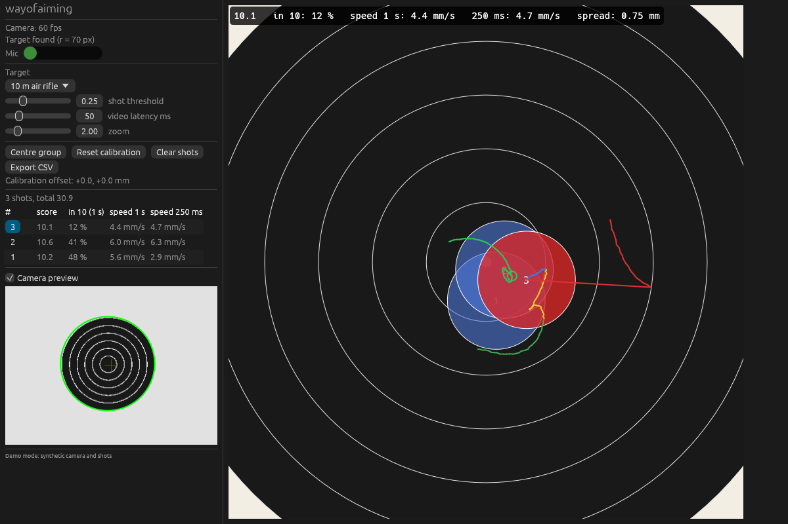

# wayofaiming

A webcam-based shooting trainer in the style of optical aim-trace systems:
a camera on the barrel watches the target, the program draws your aim trace
live, detects the shot from the microphone and analyses your hold.



## How it works

| Step | Where |
|---|---|
| Camera frame → find the black aiming mark → aim point in mm (image centre = aim) | `crates/core/src/detect.rs` |
| Microphone → shot detection (transient above threshold and background) | `crates/core/src/shot.rs` |
| Align audio/video clocks, interpolate aim at the shot, hold metrics | `crates/core/src/session.rs` |
| ISSF ring geometry and decimal scoring (10 m air rifle / air pistol) | `crates/core/src/target.rs` |
| Camera thread (nokhwa), audio callback (cpal), UI (egui) | `crates/app/src/` |

`wayofaiming-core` has no hardware dependencies and is unit-tested
(`cargo test`). The app is a thin layer around it.

Per shot it reports: decimal score, share of the last second the aim was in
the 10, mean aim speed over the last 1 s and 250 ms, and hold spread. The shot
trace is coloured green (earlier), yellow (last second), blue (last 0.2 s)
and red (follow-through).

## Hardware notes

- **Field of view is the key constraint.** A normal webcam sees ~60°; at 10 m
  the black aiming mark would be ~2 px wide. You need a narrow lens (USB
  camera with M12/CS-mount 25-50 mm lens) or a scaled-down target at short
  dry-fire distance. Aim for a black mark at least ~80-100 px across.
- **Frame rate**: higher is better for trace detail. Use `--width --height
  --fps` to request a mode; the side panel shows the actual rate.
- **Microphone**: the camera's built-in mic works. Adjust *shot threshold*
  until the meter only goes red on the shot / trigger click.

## Build and run

Linux needs ALSA and X11 libraries:

```bash
sudo apt install libasound2-dev libxkbcommon-x11-0 pkg-config
```

```bash
cargo run --release -- --demo
```

`--demo` uses a synthetic camera and shots, no hardware needed.

```bash
cargo run --release -- --list-cameras --list-mics
```

```bash
cargo run --release -- --camera 0 --target rifle --threshold 0.25
```

## Calibration

1. **Video latency**: audio arrives faster than video. Shots will look
   "late" in the trace if the latency is too low. Start at 50 ms and adjust
   the slider; a better USB camera usually needs less.
2. **Zero**: the camera axis is not the bore axis. Shoot a group of 5 with a
   zeroed gun, then press *Centre group*. (Matching real hits on paper is
   planned.)

## Status / next steps

- Calibration from real hit positions
- Saving and replaying sessions
- Camera mount rotation / mirroring options
- Manual exposure control for the camera
